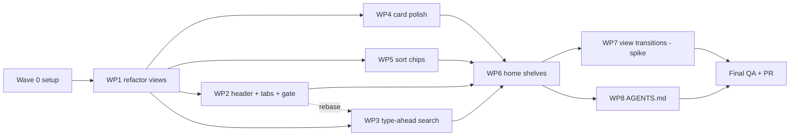

# Plan: Kids Portal Modernization (`/kids/[profileId]`)

Integration branch: `feature/kids-portal-modernization` → **one** squash
PR to the fork's `main` at the end (`--repo Ted-Rose/nibrastube`).
Work-package branches: `feature/kpm-wpN-<slug>`. They can't be nested
under the integration branch name, because git refuses `a/b` when `a`
already exists as a branch.

This document is written for an **orchestrator agent**. It assigns each
work package (WP) to an implementer agent, has a different agent review
it, and has another agent fix the findings. Every agent it spawns must be
pointed at this file plus `AGENTS.md`.

## Goal

Make the kids feed look and behave like a modern kids' video app:

- navigation that is always visible
- a "home" view built from shelves
- type-ahead search
- cleaner, faster cards
- a parent entry point that can actually be reached

Every whitelist and auth invariant, and the URL-param-driven
architecture, stay as they are. **No schema changes, no migrations, no
new dependencies.**

## Product decisions (from the owner — do not relitigate)

| Topic | Decision |
|---|---|
| Navigation position | Tabs stay **at the top** on every screen size. No bottom tab bar. |
| House icon in header | **Remove it** (redundant with the avatar "switch profile" link). |
| Watched marking | **No change.** The red progress bar under the thumbnail is enough. No badges, no dimming. |
| Personalization | **None.** No per-profile colours, no bedtime theme, no token migration for theming. |
| "One shelf per channel" | **Dropped.** |
| "Favorite channels" ranking (channels the kid watched most in the last 10 days) | **Deferred.** See "Future". Don't implement it. |
| Git workflow | WP branches → integration branch → one final PR. |

## Facts established by codebase investigation

- **`app/kids/[profileId]/page.tsx` is 555 lines.**
  - Three nested ternary chains: the title (175–191), the search
    placeholder (456–466), and the view switch (215–375).
  - 4 copy-pasted empty-state blocks (253, 278, 299, 346) covering 7+
    cases.
  - 2 copy-pasted back links (147–171).
  - `portalUrl` defined twice (73, 420).
- **The feed is entirely URL-param driven.** `parseKidsFeedParams` and
  `kidsFeedQuery` in `lib/kids-feed.ts` own `view`, `channel`, `list`,
  `date`, `sort`, `dir` and `q`.
  - The **watch page rebuilds the autoplay queue from the same params**
    (`app/kids/[profileId]/watch/[videoId]/page.tsx:43-107`).
  - So every link to a video must carry an *existing* feed context
    (e.g. home → default videos feed, Liked shelf → `?view=liked`).
    Otherwise the autoplay order silently changes.
- **Param-only navigations never fire `loading.tsx`.** Every control that
  navigates must show its own pending state, through
  `LinkPendingSpinner` (`useLinkStatus`, must sit inside a `<Link>`) or
  `useTransition`.
- **Bug: the "Parent Settings" footer is unreachable on the Videos view.**
  `KidsVideoGrid` mounts 48 cards at a time and loads more whenever an
  IntersectionObserver marker comes within 600px. The footer sits below
  the grid, so it is only reachable after every row (~2k) has mounted.
- **The header has two links to `/kids`**, the house icon and the avatar,
  both labelled "Switch profile". `/kids` depends on auth (proxy.ts
  redirects it), so these links **must** keep `prefetch={false}` (see the
  comment at page.tsx:436-440).
- **`KidsSearch` builds its URL by hand and drops `date`.** Searching
  inside a filtered History day therefore loses the date filter. It also
  uses `key={query}`, which remounts the input on every query change.
  That remount would steal focus once search updates as the kid types.
- **`VideoCard`:** `durationSeconds` is fetched (`feedVideoCols`) but
  never shown. A private `formatDuration` exists in
  `components/playlist-sortable-list.tsx`, but it has no hours support.
- **Images are plain eager ``.**
  - Lint baseline: **0 errors, 9 warnings, all
    `@next/next/no-img-element`**.
  - Keep using ``: the thumbnails come from YouTube's CDN, and
    next/image optimization would add cost. New `no-img-element`
    warnings are acceptable; **any other new warning is a finding**.
- **Typecheck baseline is clean.**
- **Theme is forced light** (`components/theme-provider.tsx`). Keep the
  existing slate/primary palette.
- **DB pool `max: 3`** (`lib/db/index.ts`, Aiven `max_connections=20`).
  More than 3 parallel queries just queue up.
- **The schema already supports the shelves:**
  - `whitelisted_videos.pinnedAt`
  - `watch_progress.{positionSeconds, completed, watchedAt}`
  - `video_reactions`
  - `watch_history`
  - `videos.viewCount`
- **Next 16.1.7's bundled React exports `ViewTransition`.**
  - Checked in `node_modules/next/dist/compiled/react`. No next.config
    flag is needed.
  - Its types only exist in `@types/react/canary.d.ts`.
  - `<Link transitionTypes>` is **not** available in 16.1.7.
- **`eslint-plugin-react-hooks` 7.0.1** (React-Compiler-era rules):
  - `set-state-in-effect`: sync props into state with the "adjust state
    during render" pattern, not `useEffect`.
  - `refs`: don't read refs during render.
- **Agent environment:**
  - The active `DATABASE_URL` in `.env` is currently the **Aiven
    `avnadmin` (production)** user. AGENTS.md claims it is `ai_agent`,
    which is stale.
  - Any dev-server UI check therefore reads from and writes to **prod
    data**. Playing a video writes `watch_progress`/`watch_history`;
    playlist and reaction actions write rows.

## Target UX

### Header + tabs (sticky, frosted)

```
Phone (<640px)                             ≥640px (sm+)
┌──────────────────────────────────┐       ┌──────────────────────────────────────────────┐
│ [🔍 Search Rock's videos…  ×] 🦁 🔒│ row 1 │ NibrasTube  [🔍 Search Rock's videos…  ×]  Rock 🦁 🔒 │
├──────────────────────────────────┤       ├──────────────────────────────────────────────┤
│  ▶      📺      ♥      ≡      ⟲   │ tabs  │ (▶ Videos) (📺 Channels) (♥ Liked) (≡ Playlists) (⟲ History) │
│Videos Channels Liked Playlists Hist│       └──────────────────────────────────────────────┘
└──────────────────────────────────┘
```

- **Header surface:** `bg-white/85 backdrop-blur-md` with a thin
  `border-b border-slate-200/70`. This replaces `border-b-4` +
  `shadow-sm`. It is sticky and respects `env(safe-area-inset-top)`.
- **Row 1:**
  - search (flex-1)
  - avatar link ("Switch profile", `prefetch={false}`)
  - 🔒 lock icon button that opens the existing Parent PIN modal
  - On md+, a "NibrasTube" wordmark on the left links to
    `/kids/<id>` with all params cleared.
  - **No house icon.**
- **Tab strip:** a `<nav aria-label="Views">` of `<Link>`s, with
  `aria-current="page"` on the active tab.
  - Phones: 5 equal columns with the icon above a short label. Active
    tab is `text-primary` on a `bg-primary/10` tile. No truncation at
    320px; fall back to `text-[11px]` if needed.
  - sm+: pills with icon + label inline. Active is `bg-primary
    text-white`.
  - The icon swaps for a spinner while that tab's navigation is pending
    (`LinkPendingSpinner fallback={icon}`).
- **Collapse on scroll (phones only):**
  - Scrolling down past ~64px hides row 1. The **tab strip stays
    pinned**. Scrolling up (≥8px) or returning near the top shows it
    again.
  - Never collapse while the search input is focused.
  - Implement with `transform: translateY(-row1Height)` on the sticky
    header, **not** by changing height or display. Changing height
    shifts layout, and scroll anchoring then flips the scroll direction,
    which makes the header oscillate.
  - The tab strip must never slide under the notch or status bar.
  - Add `motion-reduce:transition-none`.
- **The footer and the "Parent Settings" footer button are removed from
  this page.** The `/kids` picker page keeps its footer gate unchanged.

### Home = Videos tab with no `q` and no `channel`

```
Continue watching                       (hidden if empty)
[card][card][card][card] →  horizontal, scroll-snap
New for you                             (hidden if empty)
[card][card][card][card] →
Your playlists                 See all  (hidden if no playlists)
[tile][tile][tile] →
Liked                          See all  (hidden if empty)
[card][card][card] →
All videos    (Not watched)(Watched)(Newest)(Oldest)
[ existing infinite grid … ]
```

- With `q` set: no shelves. Show the "Results for "q"" grid only, as
  today.
- Drilled into a channel: no shelves, as today.
- Nothing approved at all: the empty state only, no shelves.

### Empty-state copy (final; agents must not improvise)

| Case | Icon | Message | CTA |
|---|---|---|---|
| Videos, nothing approved | Play | Ask a grown-up to pick some videos! | – |
| Channel drill-in, approved but 0 rows | Play | Videos are on the way! | All channels → `portalUrl({channel:null})` |
| Any view with `q`, no results | view icon | No videos found! / No channels found! | Clear search → same URL without `q` |
| Liked, empty | Heart | No liked videos yet! Tap the 👍 while watching. | Find videos → Videos tab |
| Playlist detail, empty | Playlist | No videos yet! Tap ⋮ on a video to add it. | Find videos → Videos tab |
| History, empty | ClockCounterClockwise | Watch a video and it'll show up here! | Find videos → Videos tab |
| History with `date`, empty | ClockCounterClockwise | Nothing watched that day! | All days → URL without `date` |
| Channels, none | MonitorPlay | Ask a grown-up to approve some channels! | – |

## Global constraints (every agent, every WP)

1. **Read `AGENTS.md` first.** Its invariants override anything here.
2. **Scope:** modify only the files your WP lists under **Owns**. If you
   need any other file, stop and report to the orchestrator.
3. **Whitelist is absolute.** Every new query that returns videos must
   `innerJoin(whitelistedVideos)` on `profileId` (copy `getKidsVideos`).
   Never widen what a kid can reach.
4. **No** schema changes, migrations, new dependencies, `middleware.ts`,
   or next.config experimental flags.
5. Links to `/kids` or `/parent/*` keep `prefetch={false}`.
6. **Pending state:** every navigation control shows a pending state
   (see Facts).
7. **Server/client boundaries:**
   - `"use client"` only where interactivity requires it.
   - Client components may only `import type` from `lib/kids-feed.ts`,
     because that file imports the DB client.
   - Icons come from `@phosphor-icons/react/dist/ssr` in server
     components and `@phosphor-icons/react` in client components.
8. **Style:**
   - semicolons, double quotes, 2 spaces, ~80 columns
   - **never run `npm run format`/prettier**: the config strips
     semicolons repo-wide
   - keep Tailwind class order sensible by hand
   - **preserve existing comments**, and move them along with the code
     they explain
   - don't add chatty new comments
9. **Kids UI language:** `rounded-[32px]`/`rounded-3xl`, `font-black`
   headings, slate/primary palette, touch targets ≥44px (prefer 48).
10. **Accessibility:**
    - `focus-visible` rings on every custom interactive element
    - `aria-label` on icon-only controls
    - `aria-current` on the active tab and the active sort chip
    - decorative thumbnails get `alt=""` when the title is rendered next
      to them
    - hover/press animations are wrapped in `motion-safe:`
11. **React hooks v7 lint rules:** no setState in effects to sync props,
    no ref reads during render.
12. **Verification before handing off:**
    - `npm run typecheck`: clean
    - `npm run lint`: 0 errors, and no new warnings other than
      `no-img-element`
    - the WP's UI/curl checks
    - If `npm` isn't on PATH, run
      `export PATH="/opt/homebrew/bin:$PATH"` first.
13. **Don't** push, open PRs, or merge. Only the orchestrator merges.
14. **Prod-data hygiene during UI checks:**
    - use only the QA profile (see Setup)
    - delete any playlist you create
    - don't un-approve or unpin anything
    - never run `db:migrate`/`db:push`

## Orchestration

### Roles

| Role | Count | Access | Responsibility |
|---|---|---|---|
| Orchestrator | 1 | full | Setup, worktrees, assigning WPs, merges, wave gates, escalation. Writes no feature code; resolves only trivial merge conflicts. |
| Implementer | 1 per WP | write, own worktree | Implement the WP spec, commit on the WP branch, return a handoff note. |
| Reviewer | 1 per WP | **read-only** + may run typecheck/lint/dev server | Must not be the implementer. Return structured findings and a verdict. |
| Fixer | 1 per review round | write, same worktree | Fix findings, reply per finding. Should be a fresh agent, not the implementer. |
| Wave reviewer | 1 per wave | read-only | Review the merged wave diff on the integration branch for cross-WP problems. |

### Wave 0 — setup (orchestrator)

1. From an up-to-date `main`:
   `git switch -c feature/kids-portal-modernization` (don't push yet).
   **Commit this plan file as the first commit.** Worktrees only see
   committed files, and every agent needs to read the plan. Keep the
   status tracker updated with commits on this branch.
2. For each WP, create its worktree **outside** the repo directory.
   Inside the repo, `tsconfig`'s `**/*.ts` include and Turbopack would
   pick up the copies.

   ```bash
   git worktree add ../nibrastube-wt/wpN -b feature/kpm-wpN-<slug> \
     feature/kids-portal-modernization
   cp .env ../nibrastube-wt/wpN/.env          # gitignored, needed
   (cd ../nibrastube-wt/wpN && npm ci)
   ```

   Create each worktree only when its wave starts, so it branches from
   the current integration head.
3. **Port map:**
   - WP*N* dev server: `npm run dev -- -p 310N` (3101…3108)
   - 3100 is reserved for the human
   - at most **2 dev servers at once** (Aiven connection limit)
   - kill with `lsof -ti:310N | xargs kill` when done
4. **QA profile:** ask the human for a `TEST_PROFILE_ID`. Ideally it is a
   dedicated "QA" kid profile with an approved channel, ≥60 videos, one
   playlist, one liked video and some watch history. Every UI and curl
   check uses it. Kid-lock cookie access works without a session (the
   URL acts as a capability URL):

   ```bash
   BASE=http://localhost:310N; PID=$TEST_PROFILE_ID
   curl -s -o /dev/null -w "%{http_code}\n" \
     -b "activeProfileId=$PID" "$BASE/kids/$PID"          # expect 200
   ```

5. Record the baseline: `npm run typecheck` (clean) and `npm run lint`
   (0 errors, 9 `no-img-element` warnings).

### Per-WP loop

```
assign → implement → review → [fix → re-review] ≤2 rounds → merge
```

1. **Implement.** The implementer gets the *Implementer template*.
2. **Review.** A fresh reviewer gets the *Reviewer template* and the
   handoff note.
3. If the verdict is `CHANGES_REQUIRED`, a fresh fixer gets the *Fixer
   template* plus the findings. Then a reviewer re-checks **only** the
   fix commits and confirms each finding is resolved.
4. After 2 fix rounds with Blocker/Major findings still open, **escalate
   to the human** with the open findings. Don't merge.
5. **Merge (orchestrator):**
   - `git switch feature/kids-portal-modernization`
   - `git merge --no-ff feature/kpm-wpN-<slug>`
   - run typecheck + lint on the integration branch
   - remove the worktree with `git worktree remove` once the wave is
     merged

### Wave plan and merge order



| Wave | WPs (parallel) | Merge order inside wave | Gate before next wave |
|---|---|---|---|
| 1 | WP1 | – | merged + wave review clean |
| 2 | WP2, WP3, WP4, WP5 | WP4 → WP5 → WP2 → WP3 (WP3 rebases on the integration branch after WP2 lands and fixes the `<KidsSearch>` call site) | merged + wave review clean |
| 3 | WP6 | – | merged + wave review clean |
| 4 | WP7 (spike), WP8 | WP7 (only if go) → WP8 | – |
| 5 | Final QA + PR | – | human approval |

### Agent prompt templates

**Implementer**

```
You implement WP<N> of docs/kids-portal-modernization-plan.md.
Worktree: <path>  Branch: <branch>  Dev port: 310<N>
TEST_PROFILE_ID=<uuid>
Read AGENTS.md, then the plan sections "Product decisions", "Facts",
"Target UX", "Global constraints" and "WP<N>".
Modify only the files under WP<N> "Owns". If you need anything else,
stop and report. Commit in small, why-focused commits (match git log
style). Don't push, open PRs or merge.
Done = every WP<N> acceptance criterion met + typecheck clean + lint
with no new non-img warnings + WP<N> verification steps run.
Return a HANDOFF NOTE:
1) Summary  2) Files changed  3) Deviations from spec + why
4) Verification output (commands + results)  5) UI steps run / not
runnable  6) Open questions
```

**Reviewer**

```
You review WP<N> of docs/kids-portal-modernization-plan.md. READ-ONLY:
don't edit files or commit.
Diff: git diff feature/kids-portal-modernization...<branch>
Inputs: the WP<N> spec, "Global constraints", "Review checklist", and
the implementer's handoff note.
Run typecheck + lint. If allowed, start the dev server on 310<N> and
run the WP<N> verification steps.
Only flag problems introduced or made worse by this diff.
Output:
| ID | Severity | File:line | Problem | Suggested fix |
then VERDICT: APPROVE | CHANGES_REQUIRED (any Blocker/Major ⇒
CHANGES_REQUIRED).
```

**Fixer**

```
You fix review findings for WP<N> on <branch> in <worktree>.
Fix every Blocker and Major finding. Fix Minor ones unless you can
justify not to. Nits are optional. Don't expand scope beyond WP<N>
"Owns". Re-run typecheck, lint and the affected verification steps.
Reply per finding: <ID> → FIXED (<sha>) | NOT FIXED (<reason>).
```

### Severity

- **Blocker**:
  - breaks a whitelist/auth invariant
  - a route or view crashes or renders wrong data
  - typecheck/lint error
  - an acceptance criterion is unmet
  - a file outside **Owns** changed
- **Major**:
  - UX regression versus this spec
  - a navigation without a pending state
  - missing a11y basics (label, focus ring, `aria-current`)
  - layout overflow at 320–360px
  - a performance regression (e.g. all images eager, N+1 queries)
  - an edge case this spec lists is not handled
- **Minor**: convention or style deviation, naming, small duplication,
  a deleted or orphaned comment.
- **Nit**: optional polish.

### Review checklist (all WPs)

- [ ] Only **Owns** files changed. No deps, schema, migrations or
      config flags.
- [ ] New video queries inner-join `whitelisted_videos` on `profileId`.
- [ ] No DB import in client components (`import type` only).
- [ ] Icons come from the right package for server vs client.
- [ ] `prefetch={false}` on `/kids` and `/parent` links.
- [ ] Every navigation control has a pending state. Param-only
      navigations don't rely on `loading.tsx`.
- [ ] Focus rings, labels, `aria-current`, `alt`, `motion-safe`, touch
      targets ≥44px.
- [ ] No horizontal overflow at 320/360px. Note that
      `html, body { overflow-x: clip }` *hides* overflow bugs, so check
      visually for clipped elements.
- [ ] Safe-area insets are respected (header top).
- [ ] Hooks v7 rules are followed. No `key` remount tricks on inputs.
- [ ] Existing comments are preserved or moved. Semicolons and double
      quotes are used.
- [ ] Feed context in hrefs keeps watch-page autoplay order correct.

## Work packages

### WP1 — Refactor the page into per-view components (behavior-preserving)

- **Branch:** `feature/kpm-wp1-refactor-views`
- **Wave:** 1
- **Depends on:** –
- **Owns:**
  - `app/kids/[profileId]/page.tsx`
  - `app/kids/[profileId]/loading.tsx`
  - `app/kids/[profileId]/_components/*` (new private folder; not
    routed)
  - `components/empty-state.tsx` (new)
  - `components/kids-tile-card.tsx` (new)
  - `components/video-grid-skeleton.tsx` (new)
  - `lib/kids-feed.ts`, **only** to add a `kidsPortalUrl` helper

**Tasks**

1. Add `kidsPortalUrl(profileId, feed, overrides?)` to
   `lib/kids-feed.ts`. It returns `` `/kids/${profileId}${kidsFeedQuery(…)}` ``
   and replaces both local `portalUrl` closures.
2. Add `_components/view-config.tsx` (server-only). It holds an ordered
   `KIDS_VIEWS` table keyed by `KidsView`: label, SSR icon, default
   title, and a search placeholder fn `(profileName, feed) => string`.
   Add two helpers:
   - `feedTitle(feed, { channelTitle, playlistName })`: replaces the
     title ternary
   - `searchPlaceholder(feed, profileName)`: replaces the placeholder
     ternary
3. Split `FeedContent` into one async server component per view, in
   `_components/`:
   - `feed-content.tsx`: dispatcher
   - `videos-view.tsx`: Videos + channel drill-in
   - `channels-view.tsx`
   - `liked-view.tsx`
   - `playlists-view.tsx`: list + detail, may split into
     `playlist-detail-view.tsx`
   - `history-feed-view.tsx`: wraps `components/history-view.tsx`

   Each view fetches only its own data. Keep these exactly as they are:
   - the existing playlist-redirect behavior
   - the `channelApproved` lookup
   - the `SaveToPlaylistProvider` wrapping
   - each view's empty-state/data conditions
4. Add `_components/feed-header.tsx`: the title row with a right-hand
   actions slot (date picker, Play all + playlist menu, sort). Render
   the view title as an **`<h1>`**; the page currently has no h1.
5. Add `_components/back-link.tsx`, used by "All channels" and "All
   playlists".
6. Add `components/empty-state.tsx`
   `{ icon, message, action?: { label, href } }`. The action is a
   primary pill `<Link>` with `LinkPendingSpinner`. Apply the
   **Empty-state copy table** above.
7. Add `components/kids-tile-card.tsx`: the shared channel/playlist card
   (thumbnail or fallback, title, "N videos", pending spinner). Both
   grids use it. Styling stays identical for now; WP4 polishes it.
8. Add `components/video-grid-skeleton.tsx`, extracted from
   `loading.tsx`. Use it both in `loading.tsx` and as the `<Suspense>`
   fallback, replacing the `FeedFallback` spinner.
9. Move `KidsSortSelect` out of the shell row into the Videos view's
   `feed-header` actions. Only shown when the grid is shown, same
   condition as today. The shell keeps `KidsViewMenu` until WP2.
10. Target: `page.tsx` ≤ ~150 lines. It keeps only auth/UUID validation,
    the header, the view menu, `<Suspense>` and the footer.

**Intended visible changes (the only ones allowed):** the skeleton
fallback, the empty-state copy and CTAs, the sort control's position,
and h1 semantics.

**Acceptance criteria**

- Every URL in the matrix below renders the same data and controls as
  before, apart from the intended changes.
- Invalid `list` still redirects to the playlists list.
- A non-UUID `profileId` still redirects to `/kids`.
- No nested ternary longer than 2 levels remains in `_components/` or
  `page.tsx`.

**Verification**

URL matrix, all with `-b "activeProfileId=$PID"`:

- `/kids/$PID`
- `?sort=age&dir=desc`
- `?q=a`
- `?q=zzzzqx` (empty)
- `?view=channels`
- `?view=channels&channel=<UC id>`
- `?view=liked`
- `?view=playlists`
- `?view=playlists&list=<id>`
- `?view=playlists&list=00000000-0000-0000-0000-000000000000` (expect
  a redirect)
- `?view=history`
- `?view=history&date=<a watched day>`
- `?view=history&date=2000-01-01` (empty)

Visible-text diff: capture each URL on the integration base and on the
WP branch, then compare the extracted text. Only the intended copy
changes may differ.

```bash
python3 - "$f" <<'EOF'
import sys, html.parser
class P(html.parser.HTMLParser):
    skip = 0
    def handle_starttag(self, t, a):
        self.skip += t in ("script", "style", "template")
    def handle_endtag(self, t):
        self.skip -= t in ("script", "style", "template")
    def handle_data(self, d):
        if not self.skip and d.strip():
            print(d.strip())
P().feed(open(sys.argv[1]).read())
EOF
```

Browser check: every tab, the drill-ins, back links, Play all, playlist
⋮ menu, the history date picker, and the skeleton during slow loads
(DevTools network throttling).

**Reviewer focus:** a behavior-preserving split, comments that moved
with the code, nothing dropped from `SaveToPlaylistProvider`, and
identical `kidsFeedQuery` usage in hrefs.

---

### WP2 — Header, top tab navigation, parent gate relocation

- **Branch:** `feature/kpm-wp2-header-nav`
- **Wave:** 2
- **Depends on:** WP1
- **Owns:**
  - `app/kids/[profileId]/page.tsx` (shell/header/footer only)
  - `app/kids/[profileId]/loading.tsx` (header skeleton only)
  - `components/kids-header.tsx` (new, client)
  - `components/kids-view-tabs.tsx` (new)
  - `components/kids-footer-gate.tsx`
  - `components/kids-view-menu.tsx` (**delete**)

**Tasks**

1. Add `KidsViewTabs`, a server component:
   `{ tabs: { key, label, href, active }[] }`. Hrefs are built in
   `page.tsx` with `kidsPortalUrl` and the same overrides the current
   menu uses (`channel: null`, plus `list: null` and `date: null` where
   they apply today). Follow the "Header + tabs" spec: `<nav>`,
   `aria-current`, phone grid vs sm+ pills, `LinkPendingSpinner` with
   the icon as fallback. The Channels tab stays active while drilled
   into a channel; Playlists stays active inside a playlist.
2. Add `KidsHeader`, a client shell. It takes `row1` and `tabs` as
   server-rendered `ReactNode` slots and implements the frosted sticky
   surface plus phone-only collapse-on-scroll exactly as specced:
   - transform-based
   - focus-aware
   - safe-area-safe
   - passive listener + `requestAnimationFrame`
   - cleanup on unmount
   - `matchMedia("(max-width: 639px)")`
3. Header row 1:
   - remove the house link
   - md+ wordmark → `/kids/<id>`
   - wrap `<KidsSearch>` in a `min-w-0 flex-1` div. Don't edit
     `kids-search.tsx`; WP3 owns it.
   - keep the avatar "Switch profile" link with `prefetch={false}`
   - add the lock button
4. `KidsFooterGate`: add `variant?: "footer" | "icon"`. The default
   `"footer"` stays exactly as today for `/kids`. `"icon"` renders
   `Button variant="ghost" size="icon-touch"` with `LockSimple`
   (or `Lock`), `aria-label="Parent settings"`, `text-slate-400
   hover:text-primary`.
5. Remove the `<footer>` and the view-menu row from the kids page.
   Delete `kids-view-menu.tsx`; grep shows no other users.
6. Update the header skeleton in `loading.tsx` to the new two-row shape,
   so the layout doesn't jump.

**Acceptance criteria**

- All 5 tabs are visible without any tap at 320, 360, 768 and 1440px
  wide, with no label truncation.
- The active tab is correct for every view and drill-in. Every tab shows
  a spinner while pending.
- On phones, scrolling down hides row 1 and keeps the tabs pinned with
  no jitter or oscillation. Scrolling up restores it. Focusing search
  keeps it expanded. The tabs never go under the notch (test with
  DevTools device "iPhone 14 Pro" and a safe-area emulation, or the
  Android APK).
- sm+: no collapse.
- The lock button opens the PIN modal. A correct PIN lands on the parent
  area; Cancel closes it.
- `/kids` picker footer gate is unchanged, including `?gate=1`
  auto-open.
- The avatar link still goes to `/kids` with `prefetch={false}`.
- The parent gate is reachable at the top of the Videos view with ~2k
  videos (the bug fix).

**Verification**

```bash
curl -s -b "activeProfileId=$PID" "$BASE/kids/$PID?view=liked" \
  | grep -o 'aria-current="page"[^>]*>' | head
```

Then the browser checks above.

**Reviewer focus:**

- the scroll logic (no layout-affecting properties, listener cleanup,
  no setState on every scroll frame; only when the collapsed state
  changes)
- keyboard navigation through the tabs
- `prefetch={false}` preserved

---

### WP3 — Type-ahead search

- **Branch:** `feature/kpm-wp3-search`
- **Wave:** 2, merged after WP2
- **Depends on:** WP1. Rebase onto the integration branch after WP2
  merges.
- **Owns:**
  - `components/kids-search.tsx`
  - the single `<KidsSearch …/>` JSX element at its call site, wherever
    WP2 left it

**Tasks**

1. Shrink the props to `{ query, placeholder }`. Build URLs from
   `usePathname()` + `useSearchParams()`: copy every param, then set or
   delete **only** `q`. This fixes the dropped-`date` bug and removes
   the duplicated param-order logic and its comment rationale. Keep the
   still-true parts of the existing comment: why it uses
   `router.*` in a transition rather than a native GET form.
2. Make the input controlled, using local `value` state.
   - **Remove `key={query}`.**
   - Sync from the `query` prop with the "adjust state during render"
     pattern, and only for *external* changes. Track the last `q` this
     component submitted in state, so a slow navigation that commits an
     older `q` never overwrites newer typing.
3. **Debounced type-ahead:**
   - 300ms after the last keystroke, navigate with
     `router.replace(url, { scroll: false })` inside `startTransition`.
   - Enter submits immediately and cancels any pending debounce.
   - Compare trimmed values and skip navigation when unchanged.
   - Clear the timer on unmount.
4. **Clear button (×):**
   - visible when `value` is non-empty
   - `aria-label="Clear search"`, ≥44px hit area
   - clears, navigates immediately and refocuses the input
   - while a navigation is pending, the spinner takes the × slot
5. **Input attributes:** `type="search"`, `enterKeyHint="search"`,
   `autoComplete="off"`. Hide the native WebKit cancel button
   (`[&::-webkit-search-cancel-button]:appearance-none`).
6. Replace the root `order-last basis-full sm:…` layout classes with
   `w-full`. WP2's wrapper now owns the layout.

**Acceptance criteria**

- Typing "dino" quickly runs one search ~300ms after the last key. The
  text never jumps back or truncates, and focus and caret stay put.
- Back-button history isn't spammed: replace is used, so Back leaves
  the page as before.
- History with `?date=X`: searching keeps `date=X`. A channel drill-in
  keeps `channel`; playlist detail keeps `list`; sort and dir are
  preserved.
- Clearing removes `q` and restores the default view (shelves on home,
  after WP6).
- Android: the on-screen keyboard shows a search key, and Enter submits.

**Verification:** browser checks, plus URL inspection after each action.

**Reviewer focus:** the stale-prop race, timer cleanup, the hooks v7
rules, and IME composition (no navigation mid-composition if it is easy
to guard with `isComposing`).

---

### WP4 — Card, tile and list polish

- **Branch:** `feature/kpm-wp4-card-polish`
- **Wave:** 2
- **Depends on:** WP1
- **Owns:**
  - `components/video-card.tsx`
  - `components/kids-video-grid.tsx`
  - `components/kids-tile-card.tsx`
  - `components/history-view.tsx`
  - `components/playlist-sortable-list.tsx`
  - `lib/format.ts` (new)

**Tasks**

1. Add `lib/format.ts` with `formatDuration(seconds: number | null)`.
   It returns `null` for null/0, `m:ss` under an hour, and `h:mm:ss`
   otherwise. `playlist-sortable-list.tsx` imports it and drops its
   private copy.
2. **`VideoCard`:**
   - **Duration badge** at the bottom-right of the thumbnail, sitting
     above the progress bar: `rounded-lg bg-black/75 px-2 py-0.5
     text-sm font-bold text-white tabular-nums`. No badge when the
     duration is null or 0.
   - Remove the `bg-black/10` overlay.
   - Move the Play button to the thumbnail centre. It is visible only
     on `group-hover`/`group-focus-visible`, with `motion-safe` scale.
   - Wrap the hover lift in `motion-safe:`. Add press feedback
     `motion-safe:active:scale-[0.98]`.
   - Link focus: `block rounded-[32px] focus-visible:outline-none
     focus-visible:ring-4 focus-visible:ring-primary/40`.
   - `alt=""` on the thumbnail. The reaction badge gets an sr-only
     "Liked"/"Disliked" label.
   - **Do not** add watched badges or dimming. The red progress bar
     stays as is.
   - New props:
     - `eager?: boolean` (default false). `loading={eager ? "eager" :
       "lazy"}` + `decoding="async"`.
     - `size?: "default" | "compact"`. Compact is for shelves:
       `p-4`, a `text-base sm:text-lg` title and a smaller play button.
   - Keep the ⋮ menu as a **sibling** of the Link; nested interactive
     elements are invalid.
3. **`KidsVideoGrid`:** add an `eagerCount` prop (default 4) and pass
   `eager={i < eagerCount}`. Give the "Show more videos" button a focus
   ring.
4. **`KidsTileCard`:** the same motion-safe/press/focus treatment,
   lazy images, and `alt=""` on covers and channel avatars.
5. **`history-view.tsx` and `playlist-sortable-list.tsx` thumbnails:**
   lazy loading, `decoding="async"`, `alt=""`, a focus ring on the row
   links, and a `motion-safe` hover.

**Acceptance criteria**

- Cards show durations: "4:05", "1:02:03".
- No badge for missing durations.
- The red progress bar is unchanged.
- The ⋮ menu still works and doesn't trigger the card lift or navigate.
- Tabbing through the grid shows a visible ring on every card. The
  play overlay appears on focus.
- With "reduce motion" enabled in the OS or DevTools, there is no lift
  or scale.
- DevTools Network on the Videos view: only the first ~4 thumbnails
  load before scrolling.

**Verification:** browser checks. `curl … | grep -c 'loading="lazy"'`
should be greater than 0.

**Reviewer focus:** card a11y, no new nested interactive elements, and
badge/overlay stacking at both sizes.

---

### WP5 — Sort chips

- **Branch:** `feature/kpm-wp5-sort-chips`
- **Wave:** 2
- **Depends on:** WP1
- **Owns:**
  - `components/kids-sort-chips.tsx` (new)
  - `components/kids-sort-select.tsx` (**delete**)
  - `app/kids/[profileId]/_components/videos-view.tsx` (sort call site
    only)
  - `components/history-date-picker.tsx` (only update its comment that
    references `KidsSortSelect`)

**Tasks**

1. Add `KidsSortChips`, a server component:
   `{ options: { key, label, href, active }[] }`.
   - Each chip is a `<Link scroll={false}>` with `LinkPendingSpinner`
     and `aria-current="true"` when active, inside a
     `<nav aria-label="Sort videos">`.
   - Hrefs are prebuilt by `videos-view.tsx` via `kidsPortalUrl(…,
     { sort, dir })`.
2. Labels and values (URL values unchanged, default first):

   | Label | Value |
   |---|---|
   | Not watched | `status:asc` |
   | Watched | `status:desc` |
   | Newest | `age:desc` |
   | Oldest | `age:asc` |

3. Style:
   - `rounded-full`, `h-11`, `font-black`
   - active: `bg-primary text-white`
   - inactive: `bg-white text-slate-600 shadow-sm`
   - a single horizontally scrollable row on phones
     (`overflow-x-auto`, hidden scrollbar), inline next to the title
     on sm+
4. Delete `kids-sort-select.tsx`.

**Acceptance criteria**

- Each chip switches the order and keeps the scroll position.
- The active chip is highlighted and a spinner shows while pending.
- `q` and `channel` are preserved.
- The watch page's autoplay follows the selected sort, as it does
  today.

**Reviewer focus:** default-param dropping (status/asc must produce
clean URLs), and no client JS needed.

---

### WP6 — Home shelves

- **Branch:** `feature/kpm-wp6-home-shelves`
- **Wave:** 3
- **Depends on:** WP1–WP5 merged
- **Owns:**
  - `lib/kids-feed.ts`
  - `components/video-shelf.tsx` (new)
  - `components/video-grid-skeleton.tsx` (add a `ShelfSkeleton` export)
  - `app/kids/[profileId]/_components/home-shelves.tsx` (new)
  - `app/kids/[profileId]/_components/videos-view.tsx`

**Tasks**

1. **Queries in `lib/kids-feed.ts`.** All return the standard
   `{ video, progress, reaction }` row shape and **inner-join
   `whitelisted_videos`**:
   - `getContinueWatching(profileId, { limit = 20 })`:
     `positionSeconds > 0`, not `completed`, and reaction is not
     `dislike`; ordered by `watchProgress.watchedAt desc`.
   - `getNewForYou(profileId, { limit = 20, days = 14 })`:
     `pinnedAt` within `days`, not completed, not disliked. Both checks
     must be null-safe, because progress and reaction are left joins
     (e.g. `completed is not true`). Ordered by
     `date_trunc('day', pinnedAt) desc, publishedAt desc nulls last`.
     A channel backfill pins hundreds of rows within seconds, newest
     upload first, so a plain `pinnedAt desc` would surface the
     channel's *oldest* uploads.
   - `getLikedVideos`: add an optional `limit`.
   - Wrap `getPlaylists` in React `cache()`, so the shelves and the grid
     (separate Suspense boundaries) share one query per request.
2. **`VideoShelf`** `{ title, seeAllHref?, children }`:
   - a heading row with an optional "See all" `<Link>` that has a
     pending spinner
   - the row itself: `flex gap-4 overflow-x-auto snap-x snap-mandatory`,
     edge-to-edge padding on phones, hidden scrollbar
   - children are `w-[72vw] max-w-72 sm:w-72 shrink-0 snap-start`
   - optional prev/next arrow buttons may be a tiny client island,
     hidden on touch (`@media (pointer: coarse)`), with `aria-label`s
3. **`HomeShelves`**, an async server component:
   - runs the 4 queries via `Promise.all`; the pool serializes the 4th,
     which is fine
   - renders, in order: Continue watching, New for you, Your playlists
     (See all → Playlists tab, using `KidsTileCard`), Liked (See all →
     Liked tab)
   - skips empty shelves
   - wraps itself in `SaveToPlaylistProvider`, so ⋮ → Save works
   - the first shelf's first 2 cards are `eager`; everything else is
     lazy
4. **Feed context in shelf hrefs**, so autoplay stays correct:
   - Continue / New → the home feed query (`kidsFeedQuery(feed)`):
     autoplay is unwatched-first across all videos, same as today
   - Liked → `kidsFeedQuery(feed, { view: "liked" })`
   - Playlists → the playlist detail URL
5. **`videos-view.tsx`:**
   - when `!q && !channel` and the profile has any videos, render
     `<Suspense fallback={<ShelfSkeleton/>}><HomeShelves/></Suspense>`
     above an "All videos" `feed-header`, with the sort chips and the
     grid in their own `<Suspense>`
   - pass `eagerCount={0}` to the grid when shelves render above it
   - with `q` or `channel` set, behave as today

**Acceptance criteria**

- Continue watching lists exactly the started, unfinished videos,
  most-recent first, and they resume at their saved position.
- New for you shows only recent pins.
- Empty shelves don't render. A profile with no videos sees only the
  empty state.
- Searching hides the shelves; clearing the search brings them back.
- Sort chips re-sort only the grid; the shelves stay.
- Tapping a Liked-shelf card autoplays through Liked.
- A Pusher-triggered refresh updates the shelves; check by pinning a
  video from the parent dashboard in another tab.
- The shelves scroll smoothly with snap on touch. No horizontal page
  overflow at 320px.
- The shelves stream inside their own Suspense boundary, and the grid
  never waits for them. Throttle the network in DevTools to confirm
  the two fill in independently.

**Verification:** browser checks, plus

```bash
curl -s -b "activeProfileId=$PID" "$BASE/kids/$PID" \
  | grep -c 'Continue watching'
```

after watching part of a video on the QA profile.

**Reviewer focus:** the whitelist joins, query correctness (the
dislike exclusion, the date_trunc ordering), the `cache()` usage, and
whether autoplay contexts are right.

---

### WP7 — View transitions (time-boxed spike, go/no-go)

- **Branch:** `feature/kpm-wp7-view-transitions`
- **Wave:** 4
- **Depends on:** WP6
- **Owns:**
  - `components/video-card.tsx` (VT wrapper only)
  - `components/kids-video-grid.tsx` (pass the VT opt-in)
  - `components/watch-experience.tsx` (player container name only)
  - `app/kids/[profileId]/watch/[videoId]/loading.tsx`
  - `app/globals.css` (reduced-motion block)
  - `types/react-canary.d.ts` (new: `/// <reference types="react/canary" />`)

**Goal:** the thumbnail morphs into the player when a grid card is
tapped.

**Known hazards (address all of them):**

- **Duplicate names abort the transition.** The same video can render
  in a shelf *and* in the grid at once. Only cards in `KidsVideoGrid`
  get a name (`VideoCard vtName` prop): `video-${id}`. The grid
  contains each video only once. Shelves get no name.
- **The watch route has `loading.tsx`.** The navigation commits the
  loading UI first, so the name must also exist there. Add a small
  client child that uses `useParams()` to read `videoId` and renders a
  player-sized box with `https://i.ytimg.com/vi/<id>/hqdefault.jpg`
  under the same name. **Verify** that `useParams` already returns the
  target params inside the loading boundary. The real player container
  in `WatchExperience` carries the same name.
- **Reduced motion:** add a `@media (prefers-reduced-motion: reduce)`
  block in `globals.css` that disables the `::view-transition-*`
  animations.
- **Version limits:** use `import { ViewTransition } from "react"`. No
  next.config flag. `transitionTypes` doesn't exist in 16.1.7.

**Go criteria** (Chrome desktop + Android Chrome/WebView, iOS Safari
best-effort):

- no console errors
- no flash or blank frame
- the animation takes under ~300ms
- back navigation doesn't break
- the swipe and auto-advance paths in `WatchExperience` are unaffected

**No-go:** if the criteria aren't met after one fix round, the
orchestrator **drops the branch** (doesn't merge) and records the
reason under "Future".

---

### WP8 — Documentation

- **Branch:** `docs/kpm-wp8-agents-md`
- **Wave:** 4
- **Depends on:** WP6, and WP7's go/no-go
- **Owns:** `AGENTS.md`, plus this plan's status tracker

**Tasks**

- Update the Architecture tree:
  - add `_components/`, `kids-header`, `kids-view-tabs`,
    `kids-sort-chips`, `video-shelf`, `empty-state`, `kids-tile-card`,
    `video-grid-skeleton` and `lib/format.ts`
  - remove `kids-view-menu` and `kids-sort-select`
- Document:
  - the parent gate now lives in the kids header (lock icon)
  - search is debounced type-ahead with `router.replace`
  - home shelves and their feed-context rule for autoplay
- Fix the stale `.env` note: the active `DATABASE_URL` is currently
  `avnadmin`. **Ask the human** before changing the wording.

## Final integration QA + PR (Wave 5)

1. Run on the integration branch: typecheck, lint, then
   `npm run build`. The build catches server/client boundary errors
   that the dev server tolerates.
2. A **QA reviewer agent** runs the full matrix: the WP1 URL matrix
   × widths 320/360/768/1024/1440, plus the Android APK or Chrome
   device emulation. It reports findings in the reviewer format. The
   fix loop applies on a `fix/kpm-qa-*` branch.
3. Orchestrator: `git push -u origin feature/kids-portal-modernization`,
   then
   `gh pr create --repo Ted-Rose/nibrastube --base main` (squash-merge).
   **Don't merge.** The human approves.
4. The PR body must include a **UI verification** section:
   1. Open `/kids/<id>` on a phone (or DevTools 360px). All 5 tabs are
      visible at the top. Tap each one: a spinner shows, then the right
      view loads, and the active tab is highlighted.
   2. Scroll down: the search row hides and the tabs stay. Scroll up:
      it returns.
   3. Tap 🔒 → the PIN modal opens → enter the PIN → you land on the
      parent dashboard.
   4. Home shows Continue watching, New for you, Playlists and Liked
      (non-empty ones only), then All videos with sort chips. Tap
      "Newest": only the grid re-sorts and the scroll position stays.
   5. Type "a" in search: results appear after a short pause without
      pressing Enter. Tap ×: the shelves return.
   6. History → pick a date → search: the date is still applied.
   7. Cards show durations. Tab through them with the keyboard: focus
      rings and the play overlay appear.
   8. Empty states: search "zzzzqx" → "No videos found!" with a Clear
      search button that works.
   9. Tap a card on desktop Chrome: the thumbnail morphs into the
      player (only if WP7 shipped).

## Future (deferred, not in this plan)

- **"Favorite channels" ordering.**
  - Rank channels by the kid's `watch_history` rows in the last 10
    days.
  - It would slot in as a new `KidsSort` value (e.g. `fav`), which
    automatically drives watch-page autoplay through
    `parseKidsFeedParams`, and/or as a home shelf.
  - **Open questions for the owner:** how to order videos within a
    favorite channel (YouTube `viewCount`, the kid's own re-watch
    count, unwatched-first?), whether it's a shelf, a sort or both,
    and whether it should become the default sort.
- Search suggestions / "did you mean" for early spellers.
- WP7 follow-ups if it was a no-go.

## Status tracker (orchestrator updates)

| WP | Implemented | Reviewed | Fix rounds | Merged | Notes |
|---|---|---|---|---|---|
| WP1 refactor views | ☐ | ☐ | 0 | ☐ | |
| WP2 header + tabs + gate | ☐ | ☐ | 0 | ☐ | |
| WP3 type-ahead search | ☐ | ☐ | 0 | ☐ | |
| WP4 card polish | ☐ | ☐ | 0 | ☐ | |
| WP5 sort chips | ☐ | ☐ | 0 | ☐ | |
| WP6 home shelves | ☐ | ☐ | 0 | ☐ | |
| WP7 view transitions (spike) | ☐ | ☐ | 0 | ☐ go / ☐ no-go | |
| WP8 docs | ☐ | ☐ | 0 | ☐ | |
| Final QA + PR | ☐ | ☐ | 0 | ☐ PR opened | |
